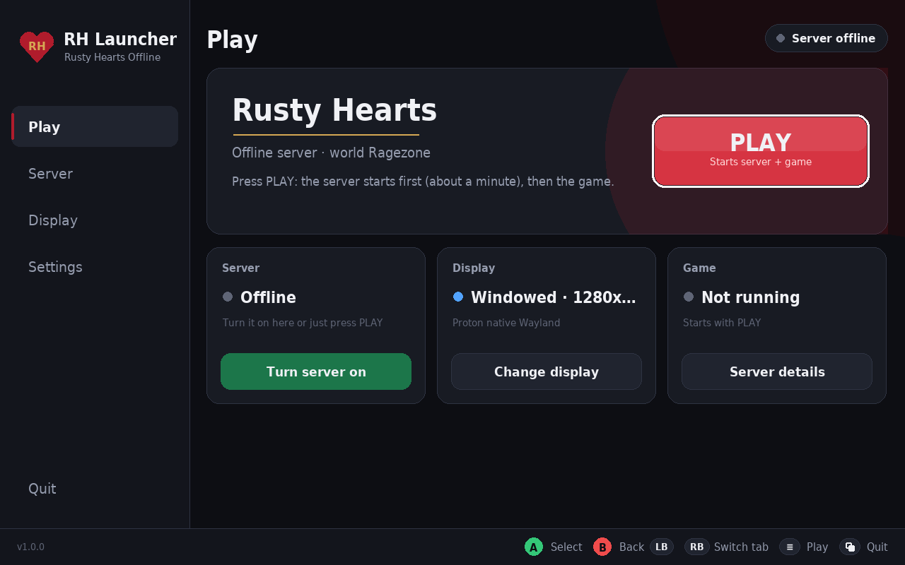
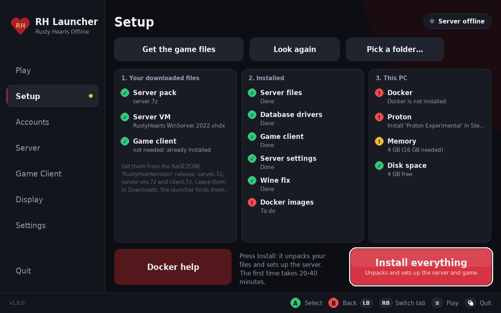
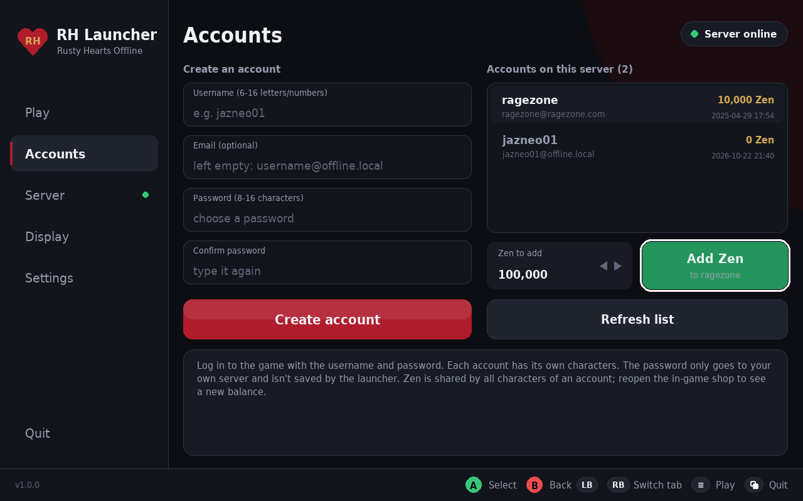
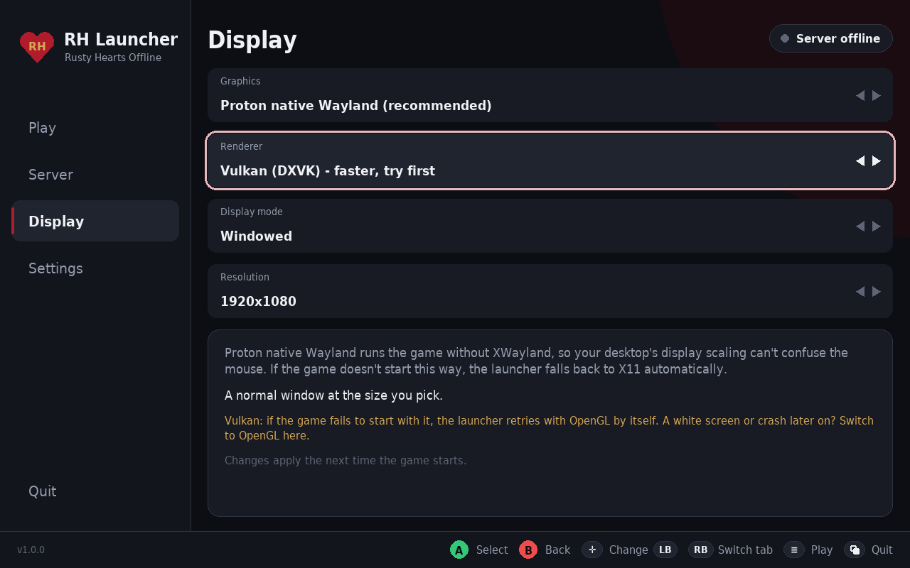

# RH Launcher: Rusty Hearts Offline for Linux

A controller-friendly launcher (Steam Deck style) that runs the community **Rusty Hearts** offline server
on Linux and plays the game with Proton. One window to install the server, turn it on and off, make game
accounts, and play.

**No game files are included.** You download the server pack, the server VM and the game client
yourself from the RaGEZONE community release. The launcher finds those downloads and installs them.

## Features

- **Setup**: finds `server.7z`, `server-vm.7z` and `client.7z` in your Downloads (or SD card / USB) and
  installs everything with one button. It also checks Docker, Proton, memory and disk space.
- **Play**: PLAY starts the server if needed, then the game.
- **Accounts**: create and delete game accounts, and add Zen for the cash shop.
- **Auto-login** (optional, experimental): types your saved login into the game's login screen.
- **Server**: on / off / restart, live status of the database, login API and game servers.
- **Display**: Proton native Wayland or X11 + gamescope; Vulkan (DXVK) or OpenGL; windowed, borderless
  or fullscreen; any resolution.
- **Steam**: Add to Steam, and it works in Gaming Mode with a controller.

| Setup | Accounts | Display |
|---|---|---|
|  |  |  |

## Requirements

- Linux x86-64 (tested on Bazzite). **16 GB RAM** or more.
- **Docker Engine with the Compose plugin**, usable by your user. On Bazzite, the developer edition
  (bazzite-dx) includes Docker.
- **Steam with Proton Experimental** (or GE-Proton).
- About **60 GB free disk space** while installing, about 20 GB afterwards.

## Install

1. Download this repository (green **Code** button → *Download ZIP*, or `git clone`) and extract it,
   for example to `~/Games/RH-launcher`.
2. Download the three game files from the RaGEZONE **RustyHeartenstein** release (see
   [docs/INSTALL-SERVER.md](docs/INSTALL-SERVER.md#where-to-get-the-files)) into your **Downloads** folder.
   Don't unpack them.
3. Run `launcher/RHLauncher.sh` and press **Install everything** on the Setup tab (20-40 minutes the
   first time).
4. **Accounts** tab: create your account. **Play**: press PLAY and log in.

Manual steps and troubleshooting are in [docs/INSTALL-SERVER.md](docs/INSTALL-SERVER.md).

Your characters live in the Docker volume `rusty-hearts-offline_sql-data`. Never run
`docker compose down -v`: that deletes them.

## How it works

- `docker/`: SQL Server for Linux, JuniorDark's Rusty Hearts API (modified for offline use), and the
  original Windows server programs running in Wine, all on localhost.
- `tools/patch-dbc-com.py`: a 23-byte fix so the server's database relay works under Wine. Its worker
  threads never initialize COM, which Windows tolerates and Wine doesn't. Originals are backed up.
- `tools/winvhdx.py`: reads the Windows database drivers out of the server VM disk, read-only, with no
  libguestfs needed.
- `tools/run-client.sh`: starts the game with Proton and the display settings from the launcher.
- `tools/autologin/`: the auto-login helper (C source included).
- `launcher/`: the GUI (Python + pygame-ce, bundled in `launcher/runtime/python`).

## Credits

- **JuniorDark**: Rusty Hearts API, Rusty Hearts Launcher and Rusty Hearts Server Manager (0BSD), and
  the RustyHearts server VM. https://github.com/JuniorDark
  This project includes a modified copy of the API (`sources/RustyHearts-API-master`) and the Server
  Manager's option templates.
- **RaGEZONE community**: the RustyHeartenstein server pack and the Rusty Hearts setup guide.
- **Stairway Games / Perfect World**: Rusty Hearts. This project is not affiliated with them.
- **7-Zip** by Igor Pavlov (GNU LGPL): `launcher/runtime/bin/7zzs`, unmodified, from
  https://github.com/ip7z/7zip ([license](launcher/runtime/bin/7zip-License.txt)).
- **Python** and **pygame-ce** (bundled runtime). The UI toolkit comes from the author's Marvel Heroes
  launcher ([marvel-heroes-steamdeck-launcher](https://github.com/Jazzneo/marvel-heroes-steamdeck-launcher)).
- Wine, Valve Proton, DXVK, gamescope, Microsoft SQL Server for Linux (Docker image).

## License

RH Launcher and the scripts are GPL-3.0 ([LICENSE](LICENSE)). The included Rusty Hearts API and
Server Manager templates keep their own 0BSD license. 7-Zip is LGPL. No game or server files are
distributed here.
